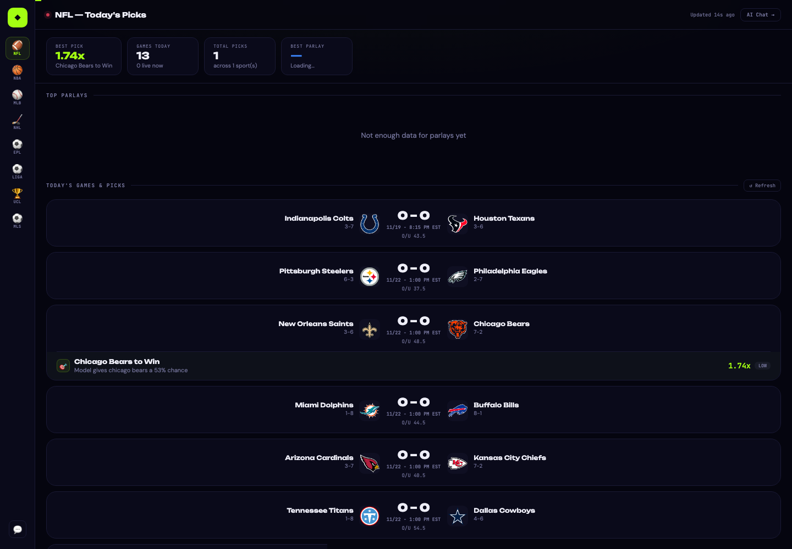

# ArbAI: real-time odds intelligence

ArbAI scans bookmaker odds across major leagues for arbitrage and value, predicts games from live ESPN data, and explains its picks in plain English through an LLM chat assistant.



<sub>Running locally with no API keys: games, records and the model pick come from ESPN's public data.</sub>

**At a glance**

- **Python and FastAPI** backend with a fetch → normalise → match → detect → rank odds pipeline.
- **Arbitrage and value detection** across bookmakers, with stake splitting for a guaranteed return.
- **Statistical predictions:** Poisson and Normal models from each team's recent schedule, combined with market moneylines.
- **LLM assistant:** LLaMA 3.3 70B via Groq, grounded in the model's real picks rather than free-form guesses.

## Features

- **Arbitrage:** groups each match's odds by bookmaker, takes the best price per outcome, and flags combinations whose implied probabilities add up to less than 100% (at least 0.5% profit). It then splits the stake so every outcome returns the same amount, using a different bookmaker for each leg.
- **Value bets:** flags prices at least 3% above the market median across 3 or more bookmakers, within odds of 1.5 to 15.
- **Game predictions:** a Poisson model for low-scoring sports and a Normal model for the rest, built from each team's recent results and combined with market moneylines. When history is thin, it falls back to a league baseline, so every game gets a prediction. Over/under probabilities are included.
- **Player props:** hit rates, averages and trends from ESPN game logs for the NBA, NFL, MLB and NHL.
- **Picks and parlays:** ranks the strongest picks with a confidence level and a reason, then combines them into parlays with combined odds, probability and payout.
- **AI chat:** answers questions such as "what's the safest parlay tonight?" using the current picks (cached for 60 s), and explains probabilities in plain English.
- **Live odds board:** live and upcoming odds for soccer, the NFL and the NBA from US, UK and EU bookmakers, cached for 30 s to respect the API quota.

**Leagues:** NFL, NBA, MLB, NHL, EPL, La Liga, Champions League and MLS (ESPN), plus bookmaker odds from The Odds API.

## How it works

```
The Odds API ─► fetch ─► extract ─► normalise ─► match ─► arbitrage / value ─► rank ─┐
                                                                                     ├─► FastAPI ─► dashboard
ESPN ─► scoreboards, schedules, game logs ─► predictor / props ─► picks / parlays ───┤
                                                                                     └─► AI chat (Groq, LLaMA 3.3 70B)
```

| Path | What's there |
| --- | --- |
| `app.py` | FastAPI app, REST endpoints and the dashboard pages |
| `chat_router.py` | `/api/chat`: the Groq-backed assistant, grounded in current picks |
| `data/` | Fetching, extracting and normalising bookmaker odds |
| `engine/matcher.py`, `arbitrage.py`, `value.py` | Grouping by match, arbitrage detection and stake splitting, value detection |
| `engine/stats.py`, `espn.py` | ESPN scoreboards, schedules, standings and team form |
| `engine/predictor.py`, `props.py`, `parlay.py` | Game predictions, player props, picks and parlays |
| `engine/stake_fetch.py`, `odds_api.py` | Live odds board and odds lookups from The Odds API |
| `frontend/` | Dashboard, game detail, live odds board and chat pages |

## Run it locally

```bash
python3 -m venv .venv
.venv/bin/pip install -r requirements.txt
cp .env.example .env          # optional: add your own keys
.venv/bin/uvicorn app:app --port 8000
```

Open http://127.0.0.1:8000. The pages call the API on port 8000, so keep that port.

| Without keys | Needs `ODDS_API_KEY` ([the-odds-api.com](https://the-odds-api.com), free tier) | Needs `GROQ_API_KEY` ([console.groq.com](https://console.groq.com)) |
| --- | --- | --- |
| Games, records, predictions, player props, model picks | Arbitrage, value bets, bookmaker-backed picks, the live odds board | AI chat |

## API

| Endpoint | What it returns |
| --- | --- |
| `GET /api/games?sport=nfl` | Today's games with team form and a value flag |
| `GET /api/game/{sport}/{game_id}` | Prediction, player props, arbitrage, value bets and box score for one game |
| `GET /api/picks?sport=nba&bankroll=1000` | Best picks and top parlays |
| `GET /api/opportunities?sport=nfl&total_stake=1000` | Arbitrage opportunities and value bets |
| `GET /api/live-odds`, `/api/live-odds/{sport}`, `/api/live-odds-flat`, `/api/value-odds` | Live and upcoming odds, flat lists and lowest-margin events |
| `GET /api/dashboard` | A summary across all leagues |
| `POST /api/chat` | The AI assistant's reply |

Interactive docs are at http://127.0.0.1:8000/docs.

## Note

ArbAI is a data-engineering and modelling project. It doesn't place bets, and nothing here is betting advice. Follow your local laws and each data provider's terms.
